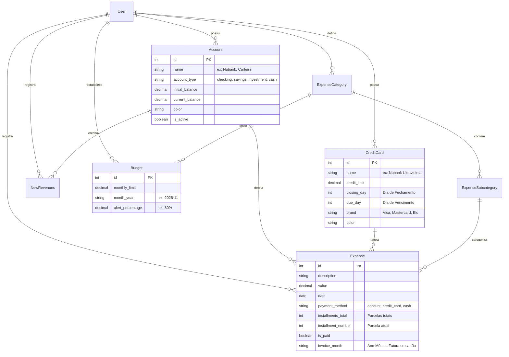

# FinApprise PF — Especificação Técnica da Transição para SaaS de Finanças Pessoais

> **Status:** Proposta de Arquitetura & Especificação do Módulo 1  
> **Data:** 19/11/2026  
> **Projeto:** [FinApprise](file:///home/nader/Documents/Projects/FinApprise)  
> **Público-Alvo:** Pessoa Física (B2C)  

---

## 1. Visão Geral e Modelo de Negócio

O objetivo desta transição é transformar o FinApprise em uma plataforma SaaS de **Gestão Financeira Pessoal (PF)** ágil, intuitiva e focada na rotina do usuário individual, reduzindo atritos de preenchimento e oferecendo clareza sobre fluxo de caixa, cartões e patrimônio.

### Diferenciais da Versão PF:
- **Isolamento por Usuário Direto (`User-Centric`):** Cada usuário autenticado acessa exclusivamente seus próprios registros (`where autor = request.user`), eliminando a necessidade de tenants complexos no início.
- **Gestão de Contas & Cartões:** Visualização unificada de saldos bancários, carteiras e faturas futuras de cartões de crédito com ciclos de fechamento/vencimento.
- **Controle de Despesas & Orçamentos (Budgets):** Limites mensais por categoria de consumo com alertas visuais de estouro.
- **Importação Bancária (.OFX / .CSV):** Lançamento automatizado via extrato dos principais bancos brasileiros (Nubank, Itaú, Inter, Bradesco, etc.).

---

## 2. Diagrama de Relacionamento de Entidades (ERD)



---

## 3. Estrutura Modular dos Novos Apps

### 3.1. App: `apps.accounts` (Contas Bancárias e Cartões de Crédito)
Substitui a referência estática `receipt_account = models.CharField(...)` atual por registros estruturados.

```python
# apps/accounts/models.py
from django.db import models
from django.contrib.auth.models import User

class Account(models.Model):
    ACCOUNT_TYPES = [
        ('checking', 'Conta Corrente'),
        ('savings', 'Poupança'),
        ('investment', 'Investimentos'),
        ('cash', 'Dinheiro / Carteira'),
        ('other', 'Outro'),
    ]
    
    autor = models.ForeignKey(User, on_delete=models.CASCADE, related_name='accounts')
    name = models.CharField(max_length=60, help_text="Ex: Nubank, Itaú, Carteira Física")
    account_type = models.CharField(max_length=20, choices=ACCOUNT_TYPES, default='checking')
    initial_balance = models.DecimalField(max_digits=15, decimal_places=2, default=0.00)
    color = models.CharField(max_length=7, default='#10b981', help_text="Hex code para UI")
    is_active = models.BooleanField(default=True)
    created_at = models.DateTimeField(auto_now_add=True)

    def __str__(self):
        return self.name

class CreditCard(models.Model):
    autor = models.ForeignKey(User, on_delete=models.CASCADE, related_name='credit_cards')
    name = models.CharField(max_length=60, help_text="Ex: Nubank Mastercard Black")
    credit_limit = models.DecimalField(max_digits=15, decimal_places=2, default=0.00)
    closing_day = models.PositiveSmallIntegerField(help_text="Dia de fechamento da fatura (1 a 31)")
    due_day = models.PositiveSmallIntegerField(help_text="Dia de vencimento da fatura (1 a 31)")
    color = models.CharField(max_length=7, default='#6366f1')
    is_active = models.BooleanField(default=True)

    def __str__(self):
        return f"{self.name} (Venc: dia {self.due_day})"
```

---

### 3.2. App: `apps.expenses` (Gestão de Gastos e Despesas)
Complementa o app existente `apps.revenues`, completando o fluxo bidirecional de caixa.

```python
# apps/expenses/models.py
from django.db import models
from django.contrib.auth.models import User
from apps.accounts.models import Account, CreditCard

class ExpenseCategory(models.Model):
    autor = models.ForeignKey(User, on_delete=models.CASCADE, related_name='expense_categories')
    name = models.CharField(max_length=80)
    icon = models.CharField(max_length=50, default='tag', help_text="Ícone Lucide ou FontAwesome")
    color = models.CharField(max_length=7, default='#ef4444')

    class Meta:
        unique_together = ('autor', 'name')

class ExpenseSubcategory(models.Model):
    category = models.ForeignKey(ExpenseCategory, on_delete=models.CASCADE, related_name='subcategories')
    name = models.CharField(max_length=80)

    class Meta:
        unique_together = ('category', 'name')

class Expense(models.Model):
    PAYMENT_CHOICES = [
        ('account', 'Débito / Pix / Dinheiro'),
        ('credit_card', 'Cartão de Crédito'),
    ]

    autor = models.ForeignKey(User, on_delete=models.CASCADE, related_name='expenses')
    description = models.CharField(max_length=150)
    value = models.DecimalField(max_digits=15, decimal_places=2)
    date = models.DateField(help_text="Data do gasto ou competência")
    
    category = models.ForeignKey(ExpenseCategory, on_delete=models.SET_NULL, null=True, blank=True)
    subcategory = models.ForeignKey(ExpenseSubcategory, on_delete=models.SET_NULL, null=True, blank=True)
    
    payment_method = models.CharField(max_length=20, choices=PAYMENT_CHOICES, default='account')
    account = models.ForeignKey(Account, on_delete=models.SET_NULL, null=True, blank=True, related_name='debited_expenses')
    credit_card = models.ForeignKey(CreditCard, on_delete=models.SET_NULL, null=True, blank=True, related_name='card_expenses')
    
    # Parcelamento
    installment_number = models.PositiveSmallIntegerField(default=1)
    installments_total = models.PositiveSmallIntegerField(default=1)
    installment_group_id = models.UUIDField(null=True, blank=True, help_text="Agrupa parcelas geradas")
    
    is_paid = models.BooleanField(default=True, help_text="Falso se fatura futura ou pendência")
    notes = models.TextField(blank=True, null=True)

    def __str__(self):
        return f"{self.description} - R$ {self.value}"
```

---

## 4. Plano de Implementação Passo a Passo

1. **Sprint 1: Modelagem e Migrações de Contas e Despesas**
   - Criação de `apps/accounts/` e reativação de `apps/expenses/`.
   - Adicionar os apps no `setup/settings.py`.
   - Executar `python manage.py makemigrations` e `python manage.py migrate`.
   - Criar seed inicial em `init_db.py` com categorias de despesas PF comuns (*Alimentação, Moradia, Transporte, Lazer, Saúde, Educação*).

2. **Sprint 2: Integração de Telas e HTMX**
   - Criação das telas de listagem e cadastro rápido de Contas, Cartões e Despesas.
   - Atualização do Dashboard consolidando:
     - Saldo Atual das Contas.
     - Gastos do Mês Atual vs Receitas do Mês Atual.
     - Previsão da Próxima Fatura do Cartão de Crédito.

3. **Sprint 3: Importador de Extrato (.OFX)**
   - View e modal de upload de arquivo `.ofx`.
   - Leitura de transações e sugestão de conciliação com categorização automática por palavras-chave.
